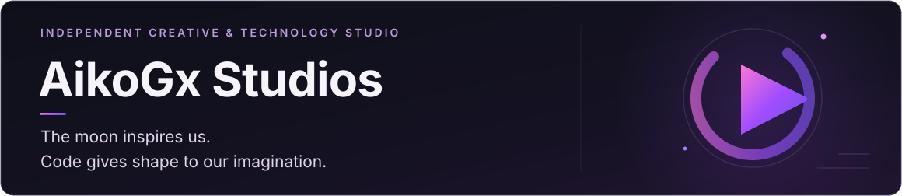

<!-- AikoGx Studios · GitHub profile · Clean minimal edition -->

  

<strong>The moon inspires us. Code gives shape to our imagination.</strong>

## About

**AikoGx Studios** is an independent creative and technology studio that combines **engineering and creativity**.

We create **websites**, **practical software for everyday workflows**, **tools for creators and developers**, **plugins for Unreal Engine**, and we are also part of the indie game development space.

We also explore **AI-supported development, distribution and support systems**.

Our mission is to build **useful technology** that feels **accessible, functional and thoughtfully crafted**.

## What we do

- Build websites and digital experiences
- Create practical desktop and web software
- Develop tools for creators and developers
- Build plugins and technical systems for Unreal Engine
- Develop indie games and interactive worlds
- Explore AI-assisted workflows and product support

## Selected projects

### Dungeon Blueprint Forge
A modular, seed-based dungeon generation system for **Unreal Engine 5.8**.  
Public documentation is available here:  
[github.com/aikogxstudios/DungeonBlueprintForge-Docs](https://github.com/aikogxstudios/DungeonBlueprintForge-Docs)

### Chaos Among Realms: Reborn
A colorful fantasy **action RPG** currently in development.  
More about the studio and future updates:  
[aikogx.es](https://aikogx.es/)

## Private work

Some of our work is developed for **private use, internal tools or client projects**.  
That means not everything we build is published as open source or shown publicly.

<!--
  FUTURE WEB PORTFOLIO — AIKOGX STUDIOS
  This section is intentionally hidden from the public profile.

  When website projects are ready to showcase:
  1. Remove the surrounding HTML comment markers.
  2. Replace the example entries with real, approved projects.
  3. Include a short description and an official URL for each site.

## Web portfolio

### Project name
Brief description of the website, technologies and the problem it solves.
[View website](https://example.com/)

  END FUTURE WEB PORTFOLIO
-->

## Links

- Website: [aikogx.es](https://aikogx.es/)
- Support: [aikogx.es/support](https://aikogx.es/support/)
- GitHub: [github.com/aikogxstudios](https://github.com/aikogxstudios)

---

© AikoGx Studios
