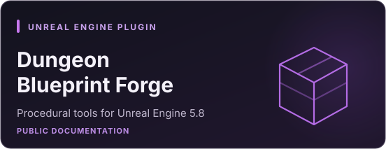
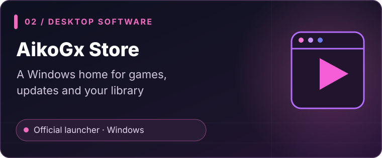
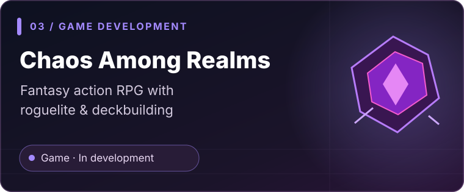

<!--
  AIKOGX STUDIOS — GitHub profile
  This README appears on github.com/aikogxstudios when placed in
  the public repository aikogxstudios/AikoGxStudios.
  All visual assets are stored locally in ./assets for long-term reliability.
-->

  

**The moon inspires us. Code gives our ideas form. Worlds bring them to life.**

*An independent studio building software, developer tools, interactive worlds and experiments in intelligent technology.*

 

## ✦ Hello from AikoGx

We are **AikoGx Studios** — an independent development studio combining **engineering and creativity**. We create practical software for everyday workflows, tools that help other creators build faster, and games designed to be memorable.

Our work ranges from **Unreal Engine systems and plugins** to **Windows applications, distribution tools and AI experimentation**. Some projects are publicly available; others remain in development or share documentation while their source code stays private.

> **Our focus:** build useful technology, make it approachable, and turn ambitious ideas into experiences people can explore.

 

## ◈ Featured projects

<table>
  <tr>
    <td width="50%" valign="top">
      
      
<strong>Dungeon Blueprint Forge</strong>

      
A modular dungeon generation system for <strong>Unreal Engine 5.8</strong>, with seed-based generation, Blueprint integration, configurable rooms, corridors and multi-level layouts.

      
<a href="https://github.com/aikogxstudios/DungeonBlueprintForge-Docs"><strong>Explore the public documentation →</strong></a>

      Documentation is public. Plugin source, binaries and project assets are not included in this repository.
    </td>
    <td width="50%" valign="top">
      
      
<strong>AikoGx Store</strong>

      
Our Windows launcher, bringing together <strong>AikoGx games, a personal library, downloads and support</strong> in a dedicated desktop experience.

      
<a href="https://aikogx.es/store/"><strong>Visit the official launcher page →</strong></a>

      Check the official website for current installer availability and version information.
    </td>
  </tr>
  <tr>
    <td width="50%" valign="top">
      
      
<strong>Chaos Among Realms: Reborn</strong>

      
A colorful fantasy <strong>action RPG</strong> bringing together real-time combat, roguelite progression and deckbuilding in a world shaped by chaos.

      
<a href="https://aikogx.es/"><strong>Follow the game's development →</strong></a>

      In development. Announcements, release details and devlogs appear on the official site.
    </td>
    <td width="50%" valign="top">
      <h3>More than one discipline</h3>
      
We also explore:

      <ul>
        <li><strong>Desktop applications</strong> and workflow tools</li>
        <li><strong>Game-engine plugins</strong> and technical systems</li>
        <li><strong>AI-assisted software</strong> and automation concepts</li>
        <li><strong>Product design</strong>, UI and interactive experiences</li>
      </ul>
      Not every experiment is a released or open-source product.
      
<a href="https://aikogx.es/"><strong>Discover AikoGx Studios →</strong></a>

    </td>
  </tr>
</table>

 

## ⌘ Our fields

| SOFTWARE & APPS | CREATOR TOOLS | INTERACTIVE WORLDS | AI & AUTOMATION |
| :--- | :--- | :--- | :--- |
| Windows applications, launchers and product workflows. | Unreal Engine plugins, procedural systems and technical documentation. | Games, prototypes and interactive experiences. | Research and experiments with useful intelligent workflows. |

 

## ⚙ How we build

We care about **clear documentation, maintainable systems, thoughtful interfaces and honest project status**. We prefer demonstrating how something works over making big promises.

Our projects are not all open source. When code or downloads are not publicly available, we aim to make that distinction clear and provide official documentation or support where possible.

 

## ↗ Explore & connect

| Destination | What you'll find |
| :--- | :--- |
| [**AikoGx Studios — Official website**](https://aikogx.es/) | Games, studio updates, devlogs and announcements. |
| [**AikoGx Store**](https://aikogx.es/store/) | Launcher information and official downloads. |
| [**Dungeon Blueprint Forge — Docs**](https://github.com/aikogxstudios/DungeonBlueprintForge-Docs) | Guides, configuration references and technical documentation. |
| [**Support & contact**](https://aikogx.es/support/) | Help, bug reporting and official contact options. |

<strong>Project licensing & availability</strong>

 

Projects may be proprietary, publicly documented, or individually licensed. A public README or documentation repository **does not imply that related source code, binaries or assets are open source**. Check each repository's license and official distribution terms before reusing or redistributing its contents.

 

---

**AIKOGX STUDIOS**

*Building tools. Creating worlds. Exploring what's next.*

© AikoGx Studios · Made with code, curiosity and a little chaos.

